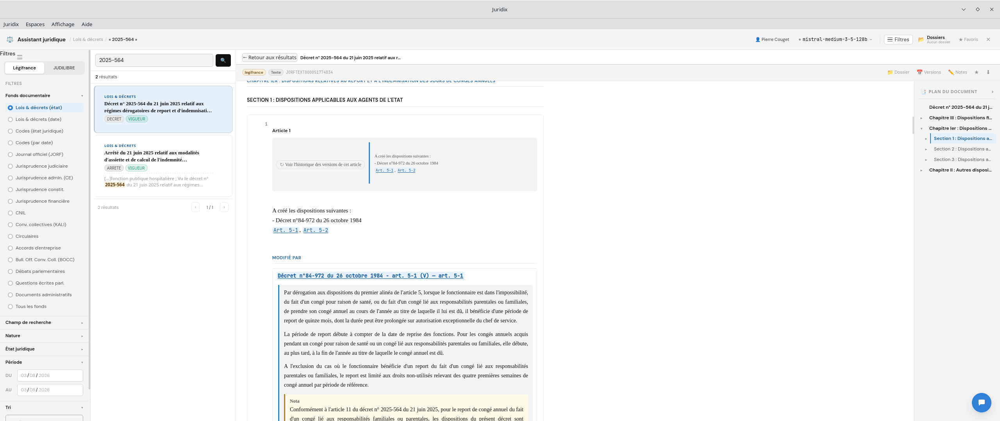
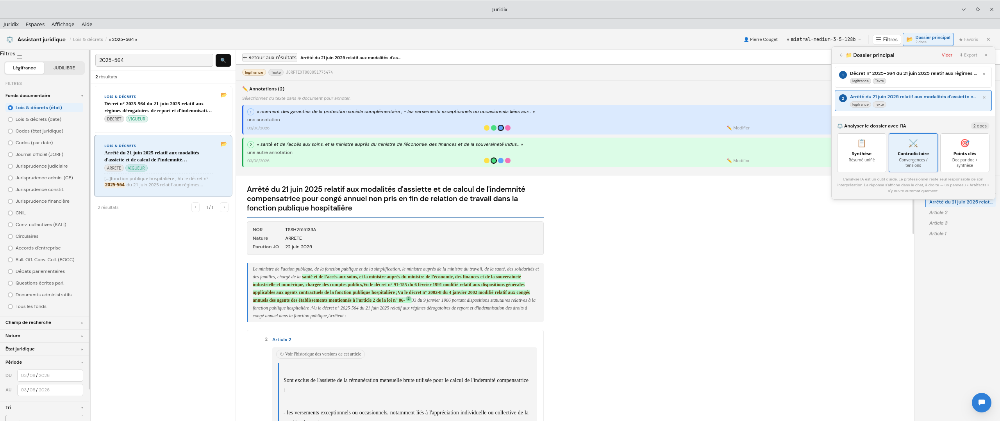
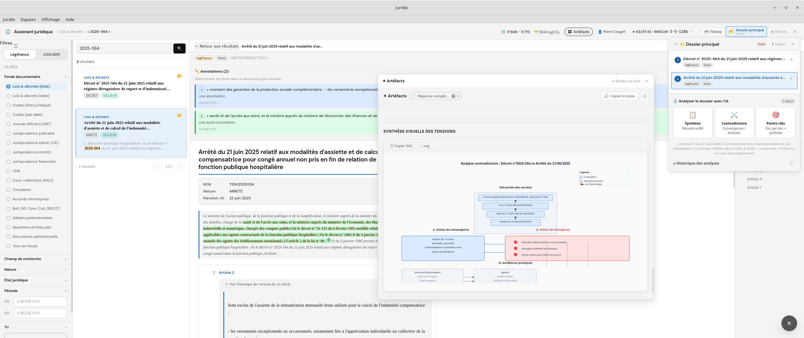
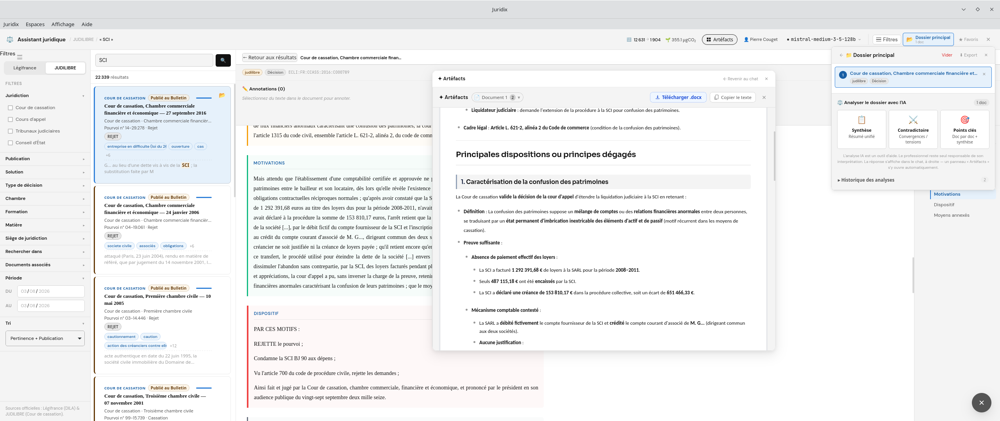

# Juridix

> Assistant juridique souverain — application desktop cross-platform (Tauri v2 · Rust · React)

[](https://github.com/Ktulu-Analog/juridix/actions/workflows/ci.yml)
[](LICENSE)
[](CHANGELOG.md)
[](https://tauri.app)
[](https://rustup.rs)

Juridix est un assistant IA desktop spécialisé en droit français. Il permet d'**interroger
directement les sources officielles** — **Légifrance** (codes, lois, décrets, JO, conventions
collectives…) et **JUDILIBRE** (jurisprudence judiciaire, administrative, constitutionnelle) —
puis de **faire traiter les documents consultés par une IA** : synthèse, analyse contradictoire,
extraction des points clés, réponses sourcées à jour — et de **surveiller l'actualité juridique**
(veille automatisée, synthèse de veille, vérification des citations produites par le modèle).


## Aperçu

<p align="center">
  
  
</p>
<p align="center">
  
  
</p>


L'application est **souveraine par conception** :

- **Aucune donnée envoyée à un tiers non choisi par l'utilisateur.** Le cœur applicatif
  (recherche, RAG, persistance) tourne entièrement en local, sans compte ni service
  obligatoire — aucun Docker, aucun cloud requis.
- **Sources juridiques officielles** via l'**API PISTE**  (Légifrance +
  JUDILIBRE), en OAuth2 direct — pas d'intermédiaire commercial.
- **IA compatible Albert**, la plateforme de la DINUM (`https://ia.numerique.gouv.fr/outils-ia/albert-api/`),
  utilisable pour le chat, les embeddings et le reranking — ou tout autre endpoint
  compatible OpenAI (Mistral, OpenAI, Ollama en local…) au choix de l'utilisateur.
- **Aucun stockage tiers** : conversations en SQLite local chiffré, index vectoriel RAG dans un
  Qdrant local ou auto-hébergé — jamais de service SaaS imposé.
- **Aucune ressource tierce au chargement** : polices et styles sont embarqués, et Juridix
  n'affiche plus d'images distantes (voir [Sécurité](#sécurité)).

---

## Version 1.1.5

Synthèse de veille, droits RGPD (export et effacement), vérification des citations, veille
juridique en tâche de fond, serveurs MCP officiels Légifrance/Judilibre et durcissement
de la sécurité. La 1.1.5 rend la **signature du pack MCP obligatoire**, remplace l'évaluation
des blocs ECharts par une analyse JSON et met à jour les dépendances vulnérables. Détail complet :
[CHANGELOG.md](CHANGELOG.md).

**À savoir en mettant à jour depuis la 1.0.0 :**

1. **Serveurs MCP HTTP déjà configurés** : à **autoriser une fois** (badge « ⏳ à autoriser » dans
   *Réglages → Serveurs MCP*, ou bannière au premier message). Les serveurs officiels n'ont rien à faire.
2. **Images** : les réponses n'affichent plus d'images, seulement leur texte alternatif.
3. **Linux sans trousseau** (Secret Service) : les identifiants sont ressaisis à chaque lancement
   (une bannière le rappelle) ; ils ne sont jamais écrits en clair sur le disque.
4. **Sauvegarde en clair** : si une ancienne base a été migrée vers SQLCipher, supprimez
   `conversations.db.pre-encryption.bak` depuis *Réglages → Données et confidentialité*.
5. **Serveurs MCP officiels déjà installés** (depuis la 1.1.4 ou avant) : à **réimporter une fois**
   (*Réglages → Serveurs MCP → Serveurs officiels*), car la signature du pack est désormais vérifiée
   et l'empreinte du binaire est enregistrée dans le trousseau.

---

## Fonctionnalités

| Capacité | Détail |
|---|---|
| ⚖️ **Recherche juridique dédiée** | Panneau de recherche Légifrance + JUDILIBRE (codes, lois, décrets, JO, conventions collectives, jurisprudence judiciaire/administrative/constitutionnelle, CNIL…), dossiers, favoris et annotations |
| 💬 **Chat IA juridique** | Espace « Juris » avec accès outillé (MCP) aux outils Légifrance (62 au total) et JUDILIBRE, via les serveurs officiels intégrés, pour des réponses sourcées et à jour |
| 🔔 **Veille juridique** | Critères enregistrés (mots-clés, fonds Légifrance, nature, code, juridictions Judilibre) rejoués en tâche de fond ; badge 🔔 sur les textes et décisions **nouveaux**, rattrapage au démarrage |
| 📝 **Synthèse de veille** | Sélection de 15 textes ou décisions au maximum, consigne facultative (« pour un DRH… »), note de veille rédigée à partir du texte intégral et téléchargeable en Word |
| ✅ **Vérification des citations** | Articles de codes, lois / ordonnances / décrets (par numéro), décisions de la Cour de cassation (par numéro de pourvoi), conventions collectives (IDCC) et passages entre guillemets sont contrôlés ; les références absentes des documents fournis sont signalées 🔎 |
| 📋 **Traitement IA des documents consultés** | Synthèse, analyse contradictoire et extraction des points clés d'un document ou d'un dossier constitué depuis la recherche juridique |
| 📚 **RAG (Qdrant)** | Ingestion PDF/DOCX (jurisprudence, doctrine, contrats…), recherche sémantique + reranking ; stockage vectoriel via **Qdrant** local ou distant |
| 🔌 **MCP** | Serveurs MCP externes (HTTP Streamable 2025-03-26) utilisés **après autorisation** ; serveurs officiels Légifrance et Judilibre importés depuis le pack et lancés en STDIO |
| 🌐 **Recherche web** | Serveur MCP dédié (disponible sur mon GitHub ou utilisez votre propre serveur MCP Web)— activé à la demande via le bouton « Web » ; alias et statut visibles en info-bulle |
| 🌾 **Pré-filtre local (optionnel)** | Un modèle de décision [Winnow](https://ollaya.dev/library/winnow) servi par [Ollaya](https://ollaya.dev) écarte, sur votre machine, les passages hors sujet avant l'envoi au LLM — activable dans Réglages ⚙ → Juridique, échec ouvert, omissions signalées ([docs/WINNOW.md](docs/WINNOW.md)) |
| 📄 **Génération Word** | Export `.docx` depuis le chat en un clic |
| 📊 **Graphiques ECharts** | Blocs ` ```echarts ` rendus interactivement |
| 🖼️ **Graphiques SVG natifs** | Blocs ` ```svg ` rendus inline avec zoom, copie et téléchargement |
| 📐 **Diagrammes Mermaid** | Flowcharts, séquences, Gantt… |
| 💾 **Persistance locale chiffrée** | Conversations en SQLite chiffré (SQLCipher), identifiants dans le trousseau du système — aucun compte requis |
| 🔒 **Données et confidentialité (RGPD)** | Export de toutes vos données (`.zip`, chiffrement AES-256 facultatif) et « Tout effacer » depuis les Réglages |
| 🖥️ **Cross-platform** | Linux · Windows (pas de version macOS dans la 1.1.0) |

---


### Stack technique

| Couche | Technologie |
|---|---|
| Desktop shell | [Tauri v2](https://tauri.app) |
| Backend | Rust · [Axum](https://github.com/tokio-rs/axum) · [tokio](https://tokio.rs) |
| Base de données | SQLite chiffré ([SQLCipher](https://www.zetetic.net/sqlcipher/)) via [tokio-rusqlite](https://github.com/programatik29/tokio-rusqlite) |
| Stockage vectoriel | [Qdrant](https://qdrant.tech) local ou distant |
| HTTP client | [reqwest](https://github.com/seanmonstar/reqwest) (rustls, HTTP/2) |
| Frontend | React 18 · TypeScript · Vite |
| Rendu | react-markdown · KaTeX · Mermaid · ECharts · SVG natif |
| Documents | [docx](https://www.npmjs.com/package/docx) (génération Word) |
| Données juridiques | API PISTE (Légifrance + JUDILIBRE) via [piste.gouv.fr](https://piste.gouv.fr)|
| IA (chat, embeddings, reranking) | Toute API compatible OpenAI — par défaut [Albert](https://ia.numerique.gouv.fr/outils-ia/albert-api/) (DINUM) |

---

## Prérequis

### Rust ≥ 1.77
```bash
curl --proto '=https' --tlsv1.2 -sSf https://sh.rustup.rs | sh
source ~/.cargo/env
```

### Node.js ≥ 18
```bash
nvm install 20 && nvm use 20
```

### Tauri CLI v2
```bash
cargo install tauri-cli --version "^2"
# ou via npm :
npm install -g @tauri-apps/cli@^2
```

### Qdrant

Qdrant est le moteur de recherche vectorielle utilisé par Juridix pour le RAG. Installez-le localement :

```bash
# Docker (recommandé)
docker run -d -p 6333:6333 -p 6334:6334 \
  -v $(pwd)/qdrant_storage:/qdrant/storage \
  qdrant/qdrant

# ou binaire natif — voir https://qdrant.tech/documentation/guides/installation/
```

L'URL par défaut est `http://localhost:6333`. Vous pouvez pointer vers une instance distante via le champ **URL Qdrant** dans les paramètres ou la variable d'environnement `QDRANT_URL`.

### Dépendances système

Le chiffrement de la base locale compile OpenSSL depuis les sources au moment du build
(feature `bundled-sqlcipher-vendored-openssl` de `rusqlite`) : **Perl** est requis
sur la machine qui compile l'application (pas sur celle qui l'exécute ensuite — le binaire final n'a aucune
dépendance OpenSSL externe). `build-essential` (Linux) et Xcode Command Line Tools (macOS) l'incluent déjà
en général ; sur Windows, [Strawberry Perl](https://strawberryperl.com/) convient.

**Linux (Debian/Ubuntu)**
```bash
sudo apt update && sudo apt install -y \
  libwebkit2gtk-4.1-dev libgtk-3-dev \
  libayatana-appindicator3-dev librsvg2-dev \
  patchelf build-essential perl
```

**macOS** — `xcode-select --install`

**Windows** — [Strawberry Perl](https://strawberryperl.com/) (pour le build) ; sinon aucune dépendance
supplémentaire (WebView2 inclus avec Windows 10/11).

---

## Démarrage rapide

```bash
git clone https://github.com/<votre-org>/juridix.git
cd juridix

cd frontend && npm install && cd ..
cargo tauri dev
```

L'interface s'ouvre automatiquement.
Le serveur Rust écoute sur `http://localhost:51873`. Cette API locale est protégée : jeton aléatoire
par lancement (en-tête `X-Juridix-Token`), contrôle de `Host` et d'`Origin`, CORS restreint aux origines
de l'application.

### Build production

```bash
cd frontend && npm install && npm run build && cd ..
cargo tauri build
```

Les installateurs sont générés dans `src-tauri/target/release/bundle/` :
- Linux : `.deb` + `.AppImage`
- macOS : `.dmg`
- Windows : `.msi` + `.exe`

> La publication 1.1.0 propose des versions **Linux et Windows** uniquement.

---

## Configuration

### Connexion au LLM

Au premier lancement, ouvrez **Paramètres** (⌘, / Ctrl+,) et renseignez :

- **Endpoint** — URL de l'API compatible OpenAI  
  ex. `https://albert.api.etalab.gouv.fr/v1`
- **Clé API** — votre token Bearer
- **Modèle** — identifiant du modèle  
  ex. `meta-llama/Llama-3.1-8B-Instruct`

La clé API, la clé Qdrant et le secret client PISTE sont conservés dans le **trousseau du système**
(Keychain / Credential Manager / Secret Service). Si le trousseau est indisponible (fréquent sous Linux
sans Secret Service), ils ne sont **pas** écrits sur disque : ils restent en mémoire pour la session et
doivent être ressaisis à chaque lancement. Les anciens résidus en clair sont migrés vers le trousseau puis supprimés.

### Accès Légifrance / JUDILIBRE (API PISTE)

Le panneau de recherche juridique et l'espace de chat « Juris » s'appuient sur l'API
officielle **PISTE** (Légifrance + JUDILIBRE). Créez un compte sur
[piste.gouv.fr](https://piste.gouv.fr), générez des credentials OAuth2, puis renseignez-les
dans **Paramètres** ou via les variables d'environnement `PISTE_CLIENT_ID` /
`PISTE_CLIENT_SECRET`. Sans ces credentials, le module juridique reste désactivé.
Les mêmes identifiants sont transmis en mémoire aux serveurs MCP officiels (jamais écrits sur disque).
L'API PISTE est ménagée par la veille (une exécution à la fois, appels espacés, arrêt au premier HTTP 429).

### Connexion Qdrant

Dans les **Paramètres**, section RAG :

- **Clé API Qdrant** — laissez vide si votre instance n'est pas sécurisée ; entrez une clé admin brute ou un JWT pour les instances protégées
- **URL Qdrant** — laissez vide pour utiliser `http://localhost:6333` (défaut), ou saisissez l'URL de votre instance distante

Si votre clé Qdrant est un **JWT** (commence par `eyJ`), vous pouvez également configurer des **tokens par collection** pour un accès granulaire en lecture/écriture.

### Variables d'environnement

| Variable | Défaut | Description |
|---|---|---|
| `PISTE_CLIENT_ID` | _(vide)_ | Client ID OAuth2 PISTE (Légifrance/JUDILIBRE) — laisser vide pour désactiver le module juridique |
| `PISTE_CLIENT_SECRET` | _(vide)_ | Client secret OAuth2 PISTE |
| `QDRANT_URL` | `http://localhost:6333` | URL de l'instance Qdrant |
| `QDRANT_API_KEY` | _(vide)_ | Clé d'accès Qdrant (admin ou JWT) |
| `EMBEDDING_MODEL` | `BAAI/bge-m3` | Modèle d'embedding Albert |
| `EMBEDDING_DIM` | `1024` | Dimension des vecteurs |
| `RERANK_MODEL` | `BAAI/bge-reranker-v2-m3` | Modèle de reranking |
| `RAG_TOP_K` | `20` | Chunks récupérés avant reranking |
| `RAG_TOP_RERANK` | `5` | Chunks conservés après reranking |
| `RAG_MIN_SCORE` | `0.15` | Score minimum (filtre qualité) |
| `RUST_LOG` | `juridix=info` | Niveau de log (`debug`, `info`, `warn`) |

Le pré-filtre Winnow n'est **pas** piloté par une variable d'environnement : c'est une préférence
utilisateur (Réglages ⚙ → Juridique). Les surcharges `JURIDIX_MCP_PACK_REPO` et
`JURIDIX_MCP_PACK_VERSION` ne sont honorées qu'en **build de développement** ; la clé publique de
signature du pack est celle du fichier `src-tauri/mcp-pack.pub`, compilée dans l'application.

### Espaces & Prompts

Les espaces sont configurés dans `src-tauri/prompts.yml` (embarqué dans le binaire, copié au premier lancement dans le répertoire de données utilisateur). L'éditeur intégré (**Espaces** → ⌘E / Ctrl+E) permet de les modifier sans toucher au YAML. Par défaut, Juridix embarque deux espaces : **Juris** (chat juridique outillé) et **Illustration** (schémas SVG).

---

## Données persistées

| OS | Chemin |
|---|---|
| Linux | `~/.local/share/Juridix/` |
| macOS | `~/Library/Application Support/Juridix/` |
| Windows | `%APPDATA%\Juridix\` |

- `conversations.db` — base SQLite des conversations, **chiffrée** (SQLCipher)
- `conversations.db.pre-encryption.bak` — présente uniquement si une ancienne base en clair a été migrée
  (créée en 0600) : à supprimer depuis *Réglages → Données et confidentialité* une fois la migration vérifiée
- `prompts.yml` — configuration des espaces

---

## Recherche juridique dédiée

Le panneau **Recherche juridique** (accessible en vue par défaut) donne un accès direct,
hors chat, aux fonds Légifrance et JUDILIBRE :

- Recherche par fond (codes, JORF, LODA, jurisprudence judiciaire/administrative/
  constitutionnelle, conventions collectives, circulaires, délibérations CNIL…)
- Consultation d'articles avec résolution inline des citations et de l'historique des
  modifications
- Constitution de **dossiers** de documents, **favoris** et **annotations** locales
- Export et synthèse IA d'un document ou d'un dossier complet (champ facultatif « Question ou point précis »)
- Case **« Compléter via Légifrance / Judilibre »** (décochée à chaque session) : les analyses de dossier
  n'utilisent aucun outil par défaut ; la case autorise uniquement ces deux serveurs, avec obligation de
  signaler les compléments
- **Vérification des citations** : les références d'articles citées dans une réponse sont contrôlées sur
  Légifrance (✅ en vigueur, ⚠️ abrogé ou plus en vigueur, ❌ introuvable) en arrière-plan. Pour les
  réponses produites à partir de documents, toute référence (y compris lois, décrets, arrêtés) qui ne figure
  dans rien de ce qui a été fourni au modèle est marquée 🔎 *hors sources*.
  La vérification couvre aussi :
  - les **lois, ordonnances et décrets cités par leur numéro** (✅ en vigueur, ⚠️ abrogé, ⚠️ date citée
    différente de celle du texte, ❓ non retrouvé) ;
  - les **décisions de la Cour de cassation citées par leur numéro de pourvoi**, recherchées dans
    Judilibre (✅ retrouvée, avec chambre, date, solution et publication dans l'info-bulle ; ⚠️ date ou
    chambre citées qui ne concordent pas ; ❓ non retrouvée). **❓ n'est pas une preuve d'inexistence** :
    Judilibre ne contient pas toutes les décisions ;
  - les **conventions collectives citées par leur IDCC** (✅ retrouvée ; pas d'état « en vigueur » : il n'existe
    pas pour une convention dans Légifrance) ;
  - les **passages entre guillemets** : rattachés sans ambiguïté à un article de code, ils sont comparés au
    texte de l'article sur Légifrance (✅ identique, ⚠️ proche ou absent) ; sinon, ils sont comparés aux
    documents fournis au modèle (✅ retrouvé, ⚠️ proche), sans verdict négatif : un passage absent des
    documents peut provenir d'un résultat d'outil ou d'un extrait dont le texte n'est pas conservé.

  - les **décisions citées par leur ECLI**, du **Conseil d'État** et des **cours et tribunaux administratifs**
    (numéro de requête, recherchées dans la jurisprudence administrative de Légifrance par le champ « numéro de
    décision » : la décision n'est retenue que si la juridiction, le numéro — et, pour un ECLI, la date que
    celui-ci porte — du titre du résultat correspondent ; la lecture de la décision, quand l'API l'accepte,
    doit confirmer et ne peut que l'écarter), et des **cours d'appel** (numéro de RG, Judilibre).
    Un numéro de RG se répète d'une cour à l'autre : l'arrêt n'est retenu que si la date citée le désigne, ou si
    le siège cité (appliqué comme filtre `location` de Judilibre) le désigne, sinon ❓. Un ECLI du Conseil constitutionnel, de la CJUE ou d'une juridiction non interrogée est
    signalé ⚪ (non vérifiable), jamais ✅.

  Non couverts pour l'instant : les arrêtés et circulaires (ancrage seul).

  **Fiche d'une décision.** Le bouton ⛓ d'une décision vérifiée ouvre sa fiche : juridiction et niveau (juge du
  fond ou Cour de cassation), puis les rapprochements que l'API fournit — décision attaquée (chaînage arrière),
  décision suivante (chaînage avant), rapprochements de jurisprudence (Judilibre), liens typés (Légifrance) —
  chacun avec sa provenance (base et champ), et sa position dans le temps (antérieure / postérieure) calculée
  d'après les dates. Ce que les API ne fournissent pas est dit : les décisions qui citent celle-ci (« cité par »)
  et les revirements de jurisprudence ne sont fournis ni par Judilibre ni par Légifrance ; l'absence d'un
  rapprochement ne prouve donc pas qu'il n'existe pas.

## Veille juridique

Enregistrez des critères de veille (mots-clés, fonds Légifrance, nature, code, juridictions Judilibre) :
Juridix les rejoue en tâche de fond (toutes les 6 h au minimum, 24 h par défaut) et signale les textes et
décisions **nouveaux** par un badge 🔔. Au démarrage, la période où l'application était fermée est
rattrapée. Les résultats s'ouvrent directement dans la visionneuse.

**Synthèse de veille** : cochez des textes ou décisions (15 au maximum), ajoutez au besoin une consigne
(« pour un DRH… »), puis *Synthétiser*. Le texte intégral de chaque élément est chargé depuis
Légifrance / Judilibre et le modèle rédige, **sans aucun outil**, une note factuelle (synthèse générale,
textes par catégorie, points d'attention). La note, complétée de la liste exacte des textes analysés,
tronqués ou non chargés, se télécharge en fichier Word.

## RAG — Ingestion de documents

1. Lancez **Qdrant** (`http://localhost:6333` par défaut)
2. Ouvrez **Ingestion RAG** (⌘R / Ctrl+R)
3. Créez ou sélectionnez une collection Qdrant
4. Déposez vos fichiers PDF, DOCX, TXT ou Markdown (jurisprudence, doctrine, contrats…)
5. Activez le RAG dans une conversation via le bouton 📚

Pipeline : extraction texte → chunking → embeddings (Albert) → stockage Qdrant → reranking (BGE) → injection contexte.

> **Note** : les valeurs de chunk sont exprimées en **caractères** (et non en tokens).  
> Les valeurs par défaut sont `chunk_size = 2048` et `chunk_overlap = 0`.

Un indicateur en temps réel (vert/rouge) dans la modale RAG signale l'état de la connexion Qdrant.

---

## Rendu graphique

Juridix supporte plusieurs formats de visualisation directement dans le chat :

- **ECharts** — blocs ` ```echarts ` avec JSON de configuration
- **SVG natif** — blocs ` ```svg ` rendus inline avec barre d'outils (copie presse-papier, téléchargement `.svg`)
- **Mermaid** — flowcharts, diagrammes de séquence, Gantt, etc.
- **KaTeX** — formules mathématiques inline et bloc

> Depuis la 1.1.0, **les images ne sont plus affichées** dans les réponses : leur texte alternatif est
> montré à la place (une image Markdown pouvait servir de canal d'exfiltration par injection de prompt).

---

## MCP — Outils externes

Juridix supporte le [Model Context Protocol](https://modelcontextprotocol.io) en transport **HTTP Streamable** (spec 2025-03-26), compatible avec `mcp.data.gouv.fr` et tout serveur FastMCP stateless. C'est notamment via des serveurs MCP que l'espace de chat « Juris » accède aux outils Légifrance (62 outils) et JUDILIBRE.

Ajoutez des serveurs MCP dans les paramètres. Chaque serveur peut recevoir un **alias** affiché dans l'interface. Les outils disponibles sont découverts automatiquement et les statuts de connexion sont visibles en info-bulle au survol des boutons MCP et Web.

Le bouton **Web** active un serveur MCP dédié à la recherche web (configurable séparément) ; il n'est inclus dans les appels que lorsqu'il est allumé.

### Serveurs officiels (Légifrance, Judilibre)

Juridix importe ces deux serveurs depuis la release GitHub du pack (empreinte SHA-256 vérifiée ; les autres
serveurs du pack sont ignorés) et les lance automatiquement en **STDIO** comme sous-processus. Le panneau
« Serveurs officiels » (Réglages → Serveurs MCP) permet d'importer / mettre à jour, de voir l'état et
d'activer chaque serveur. Il affiche le nombre réel d'outils et laisse choisir ce qui est exposé au LLM :

| Profil | Outils | Coût approximatif |
|---|---|---|
| **Essentiels** (défaut) | 6 + 3 | ≈ 1 450 jetons par requête |
| **Tous** | 62 + 8 | ≈ 7 600 jetons par requête |
| **Personnalisé** | liste au choix | annoncé avant de choisir |

La signature minisign de chaque release du pack (`checksums.txt.minisig`) est **obligatoire** : elle est
vérifiée avec la clé publique `src-tauri/mcp-pack.pub` (la même que Demeter), puis le SHA-256 de chaque
archive est contrôlé. Une signature absente ou invalide, ou une signature d'une autre release, fait refuser
l'installation, et tout retour à une version antérieure est refusé.

### Autorisation des serveurs externes

Un serveur MCP externe n'est utilisé par le modèle qu'après une **autorisation donnée une fois pour tous ses
outils** (fenêtre listant les outils à l'ajout, ou bannière non bloquante au premier usage) — sans
confirmation à chaque appel. L'autorisation est liée à une empreinte des outils : si le serveur les
modifie, elle tombe et doit être renouvelée. Seuls les outils annoncés au modèle sont exécutables. Les
serveurs distants (hors `localhost`) portent un badge « ⚠ distant » et exigent une confirmation explicite
à l'ajout. Détails : [docs/MCP_AUTORISATION.md](docs/MCP_AUTORISATION.md).

---

## Données et confidentialité (RGPD)

Dans **Réglages → Données et confidentialité** :

- **Exporter mes données** — archive `.zip` : conversations (JSON et Markdown lisible), veilles, dossiers,
  favoris, annotations, historique, réglages d'interface, autorisations MCP. Chiffrement AES-256
  facultatif ; **jamais** d'identifiants.
- **Supprimer la sauvegarde en clair** laissée par la migration vers SQLCipher (écrasement puis suppression).
- **Tout effacer** — base, prompts, trousseau, `localStorage`, sauvegarde ; confirmation par saisie de
  `EFFACER`. L'effacement se fait en deux temps et reprend au démarrage suivant en cas d'arrêt brutal.

> **Limites** : l'effacement écrase les fichiers avant suppression, mais sur un SSD seul le chiffrement
> intégral du disque garantit un effacement physique. Les collections Qdrant distantes ne sont pas concernées.

---

## Sécurité

- **API locale protégée** : jeton aléatoire par lancement, contrôle de `Host` (anti DNS-rebinding) et
  d'`Origin`, CORS restreint ; un site web ouvert dans le navigateur ne peut plus lire les conversations
  ni utiliser les identifiants. Les routes sensibles (pack MCP, veille, vérification de citations)
  exigent le jeton.
- **Aucun contenu distant** : plus d'images externes ni de proxy d'images ; polices et KaTeX embarqués
  (plus de Google Fonts ni de jsDelivr) ; CSP resserrée.
- **Secrets** : trousseau système, jamais de repli en clair sur le disque.
- **MCP HTTP** : schémas non HTTP et adresses link-local / métadonnées cloud refusés ; redirections
  revalidées à chaque saut (3 maximum, sans rétrogradation https → http).
- **Rendu SVG** par sanitisation DOM (liste blanche), extraction DOCX bornée (bombe ZIP), journaux sans
  trace de clé, CI avec actions épinglées par SHA et job d'audit hebdomadaire (`cargo audit` + `npm audit`).
- **Réserve connue** : ECharts < 6.1.0 (XSS d'infobulle, CVE-2026-45249), neutralisée par échappement des
  noms de séries en attendant la montée de version.

---

## Souveraineté par conception

Juridix est pensé pour un usage juridique professionnel sans dépendance à une plateforme
étrangère ni à un service tiers non maîtrisé :

- **Exécution locale** — le backend Rust/Axum tourne dans le processus Tauri sur le poste
  de l'utilisateur ; aucune donnée ne transite par un serveur Juridix (il n'y en a pas).
- **Sources officielles françaises** — Légifrance et JUDILIBRE sont interrogés en direct
  via l'API **PISTE** de la DINUM, avec les identifiants OAuth2 propres à l'utilisateur.
- **IA souveraine par défaut** — le endpoint LLM proposé par défaut est **Albert**, l'API
  de la DINUM/Etalab ; tout autre endpoint compatible OpenAI (auto-hébergé via Ollama,
  ou tiers au choix) reste utilisable.
- **Données chiffrées au repos** — l'historique des conversations (base SQLite locale)
  est chiffré par [SQLCipher](https://www.zetetic.net/sqlcipher/) ; les identifiants
  sensibles (bearer LLM, clé Qdrant, secret client PISTE) sont stockés dans le trousseau
  du système d'exploitation (Keychain/Credential Manager/Secret Service), jamais en clair
  sur disque ou dans le `localStorage` de l'interface (sous Linux sans trousseau, ils sont ressaisis à
  chaque lancement). Détails et limites connues :
- **Aucun stockage tiers** — conversations et annotations en SQLite local ; index vectoriel
  RAG dans une instance Qdrant locale ou auto-hébergée par l'utilisateur. Aucune télémétrie,
  aucun compte, aucune synchronisation vers un service cloud imposé. Juridix ne contacte aucun hôte web
  hors de ses services (sources juridiques, LLM, Qdrant et serveurs MCP configurés par l'utilisateur).

---

## Contribution

Les contributions sont les bienvenues ! Consultez [CONTRIBUTING.md](CONTRIBUTING.md) pour les détails.
L'historique des versions est dans [CHANGELOG.md](CHANGELOG.md).

```bash
# Fork → branche
git checkout -b feat/ma-fonctionnalite

# Vérifications avant PR
cargo fmt && cargo clippy
cd frontend && npm run typecheck
```

---

## Licence

[AGPL-3.0](LICENSE) — © 2026 **Pierre Couget** — [ktulu.analog@gmail.com](mailto:ktulu.analog@gmail.com)
